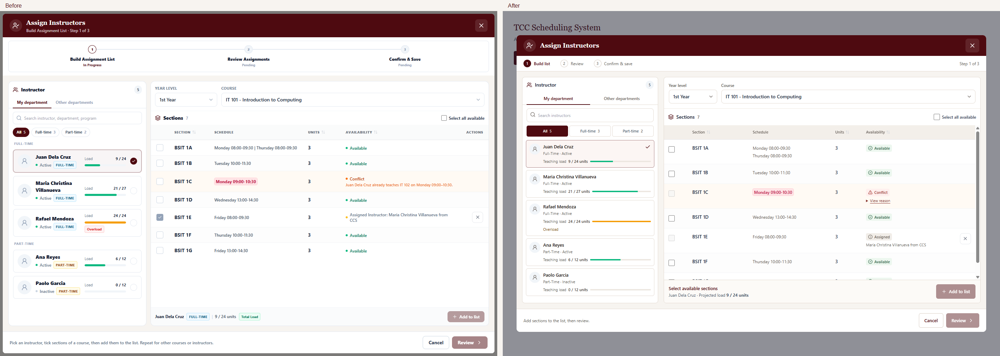
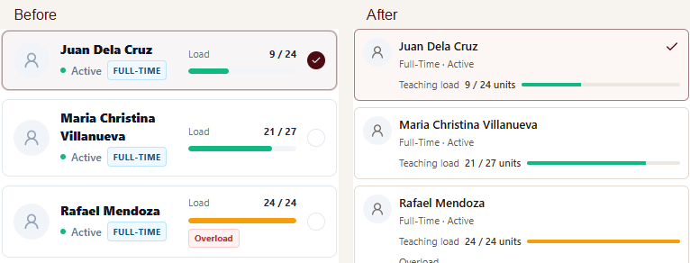
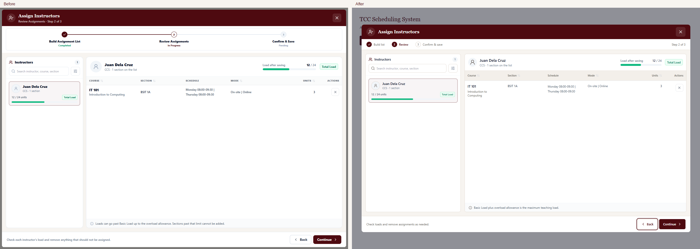
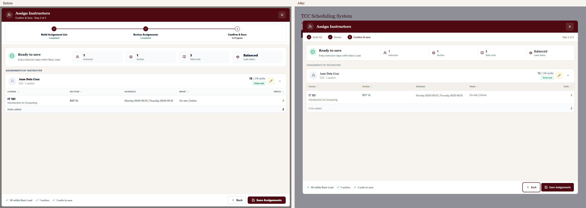
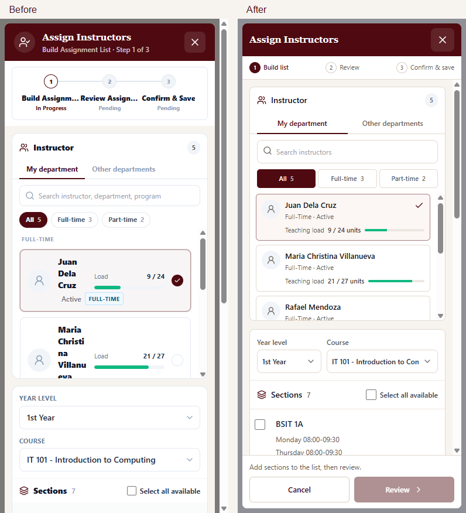

# Assign Instructors modal redesign

Completed 2026-10-23 in the existing `AutoAssignModal`. Eligibility, conflict detection, teaching-load ceilings, program/department scope, linked meeting groups, removal confirmation, and save payloads remain unchanged. No production dependencies were added.

## Audit and completed workflow

| Step | Initial issue | Updated interface | Health |
| --- | --- | --- | --- |
| 1. Select an instructor | Fixed 400px pane; names competed with employment badges, group headings, and a separate load column. Mobile names wrapped into narrow columns. | Responsive 30% pane; compact identity rows; plain employment/status text; numeric load with a small bar; clear selected state. Search and all existing filters remain. | Passed |
| 2. Choose course and sections | Tall progress indicator; long conflict lines; assigned sections looked checked like new selections. | Compact progress row; 70% right pane; real checkboxes; Available, Conflict, Assigned, and On list labels; expandable conflict reasons. | Passed |
| 3. Review assignments | Heavy type, inconsistent pane proportions, and repeated instructions distracted from the pending list. | Consistent 30/70 grid, wrapped course details, projected load, removal controls, and pending counts. Back/Continue remain in a fixed footer. | Passed |
| 4. Confirm and save | Oversized metric cards; a changed conflict could disable saving while the heading still said “Ready to save.” | Compact summary; grouped assignments; accurate blocked-state heading using the existing validation result. Saving disables editing/dismissal; failed saves retain the list for retry. | Passed |

TCC maroon, white, cream surroundings, and neutral borders are preserved. The modal is capped at 1360px. On smaller screens, panes stack and table rows reflow. Header and footer stay visible; Add to list becomes sticky once mobile sections are selected.

## Before and after

The referenced screenshot attachment was not present. The baseline was captured from the existing component with fixture data, then compared with the updated component using the same course, data, state, and viewport. No real assignments were changed.

Additional captures: [conflict explanation](assign-instructors-redesign/08-conflict-reason.png), [mobile selection](assign-instructors-redesign/09-mobile-selected.png), [1024px desktop](assign-instructors-redesign/10-small-desktop.png), and [sample save result](assign-instructors-redesign/06-success.png).

## Verification

- 12 focused tests passed, including the four original tests. Coverage includes grouped payloads, three-step saving, failed-save retry, search/filters, unit limits, conflict blocking, changed pending conflicts, scroll lock, focus restoration, Escape, and saving protection.
- Targeted ESLint and production TypeScript/Vite build passed.
- Chromium completed the sample workflow; real Tab/Shift+Tab remained inside the modal. No runtime exceptions were recorded.
- Checks at 320×740, 390×844, 768×1024, 1024×768, 1440×1000, and 1920×1080 found no dialog overflow/clipping. Footer actions stayed visible; desktop panes measured 30/70.
- Axe found zero WCAG A/AA rule violations in five checked states. Chromium retained table/row/cell semantics on mobile. This is not a claim of full accessibility compliance.

Live authenticated saving, manual screen-reader use, and external font delivery were not tested. Both visual sets used matching font fallbacks; application font declarations remain intact.

The sample preview is available at `/assign-instructors-preview.local/` while Vite is running. It uses the actual component with fixture callbacks and does not submit to the backend or alter login storage. The same component changes are active in normal Schedule Management.
