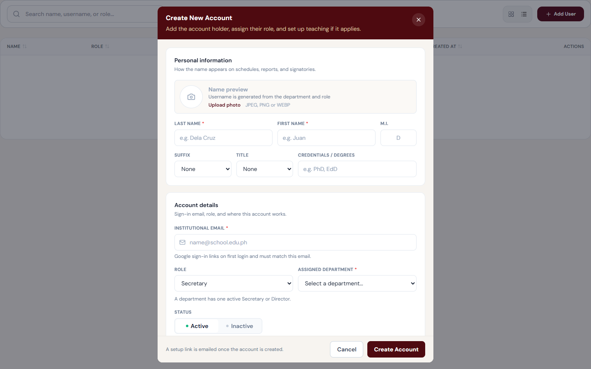
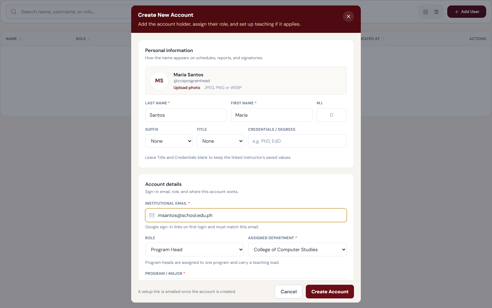
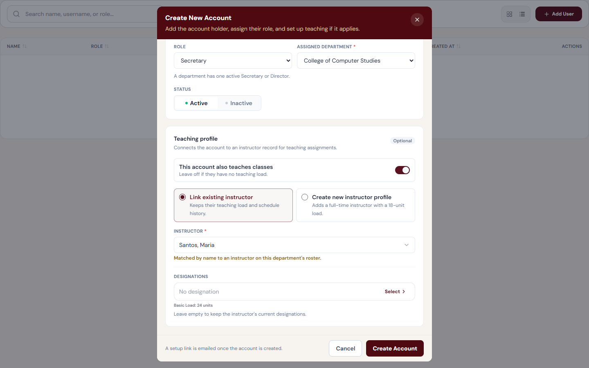
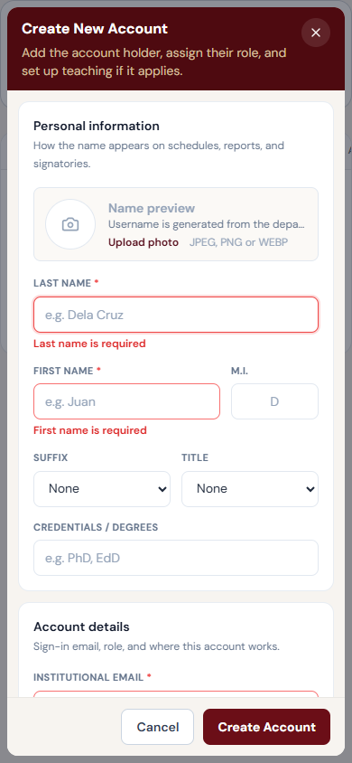
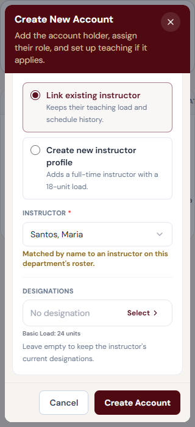

# Create New Account modal redesign

Completed 2026-11-14 in `src/pages/vpaa/Users.tsx` (the VPAA **Users** page; the same form serves **Edit User Account**). The API payload, validation rules, role options, username generation, Secretary/Director slot notice, instructor link/create logic, and designations are unchanged. No dependencies were added.

## Audit (before implementation)

Ranked by impact. **P1** = wrong behavior or main layout problem, **P2** = usability/accessibility, **P3** = polish.

| # | Priority | Finding | Resolution |
| --- | --- | --- | --- |
| 1 | P1 bug | **Add User did not clear the profile photo.** After editing a user and cancelling, the next new account opened with that user's photo and sent it as `profile_picture`. The Title and Credentials errors were not cleared either. | Reset now lives in one `openCreateModal()` that clears the photo, the file input, and every field error. Covered by a test (`profile_picture: null`). |
| 2 | P1 layout | Create mode used the 1024px `wide` modal with a fixed two-column grid. For Secretary/Director accounts (the default role), the right **Teaching Profile** column showed only a checkbox above a large empty area. | Single 672px column (`form` size, the same as Edit). Teaching profile is a compact section that grows only when teaching applies. |
| 3 | P1 layout | Photo, Last name, First name, M.I. and Suffix were packed into one row inside a ~520px column, which squeezed the name fields. | 12-column grid: Last name / First name / M.I., then Suffix / Title / Credentials. On mobile it collapses to a 6-column grid. |
| 4 | P2 a11y | Errors appeared beside fields, but inputs had no `aria-invalid` or `aria-describedby`, and after a failed submit focus stayed on the button. The first error could be off-screen in the scroll area. | Invalid inputs set `aria-invalid` and point to their error message. After client-side or 422 validation fails, focus moves to the first invalid field. |
| 5 | P2 | The generated username (`{dept code}{role}`) was invisible until the success toast. | Read-only identity preview shows the formatted name, initials or photo, and `@username` as the form is filled in. Display only; provisioning is unchanged. |
| 6 | P2 | The role only affected the form silently (Program field appears, teaching becomes required). | A short hint under Role states what the role implies. It is replaced by the existing slot-conflict notice when that applies. |
| 7 | P2 | Teaching radios were plain rows with low contrast for the selected state, and the checkbox read as a minor option. | The checkbox is now an accessible switch (`role="switch"`). The two instructor options are bordered choice cards, side by side from `sm` up. Fields reveal with a 180ms ease, which is off under `prefers-reduced-motion`. |
| 8 | P3 | Uppercase maroon section eyebrows over hairlines, a tiny red "X" for removing the photo, and a Status dropdown for a two-value choice. | White section panels with sentence-case headings and one-line purposes, text buttons for Upload/Change/Remove photo, and a segmented Active/Inactive control (native radios). The footer explains that a setup link is emailed. |

Checked and found correct (no change): the Program field only for Program Heads, cleared when the role or department changes. Department is required for every role. The Secretary/Director single-slot notice is advisory, and the API decides. Deans and Program Heads must link or create an instructor. Name match preselects **Link**, and creating a duplicate is blocked with **Link instead**. Teaching fields are never sent when teaching is off (`faculty_mode: 'none'`). Edit mode hides the teaching profile.

### Future work (not done)

- Edit mode cannot view or change the linked instructor or designations; that requires an API change.
- Native `<select>`s remain for Suffix, Title, Role, Department and Program. They are accessible and work well on mobile; swap them for `SearchableSelect` only if departments grow long.
- The role hint text describes only rules enforced in code. Product owners may want fuller role descriptions.

## Result

## Verification

- `src/pages/vpaa/Users.test.tsx`: the 7 original tests and 4 new ones pass. The new tests cover the teaching switch revealing and hiding fields, the Program field only for Program Heads, `aria-invalid` with focus on the first error, and the name/username preview with `is_active` and a cleared photo in the payload.
- ESLint shows no errors for the page or test; the 3 warnings were already there. TypeScript reports no errors in the page.
- A fixture preview (`account-modal-preview.local/`, fake axios adapter, no network) was captured at 1440×900, 768×1024, 390×844 and 320×700 for the empty, error, Program Head and teaching states. The dialog fits the viewport in every state, with no horizontal scroll and no console errors.
- Not tested: live backend saving, a manual screen reader pass.
