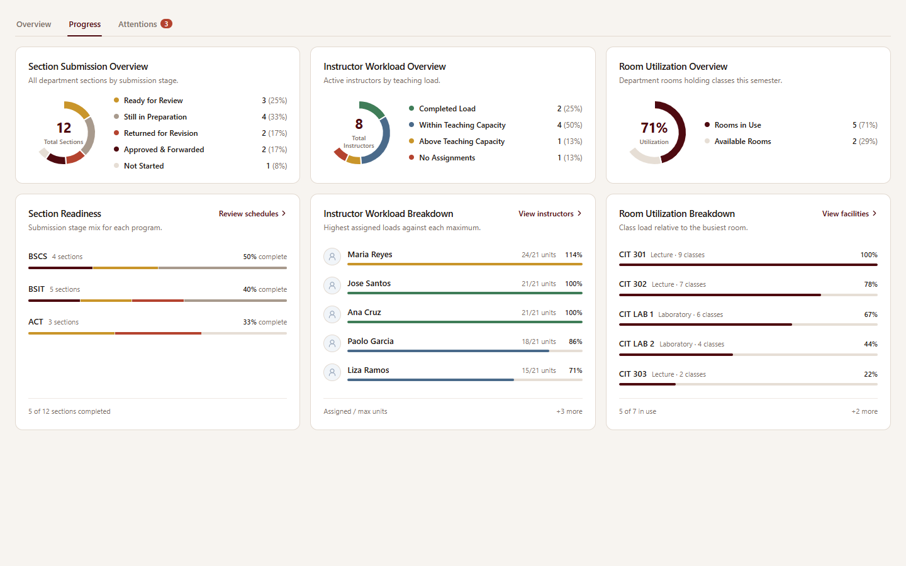
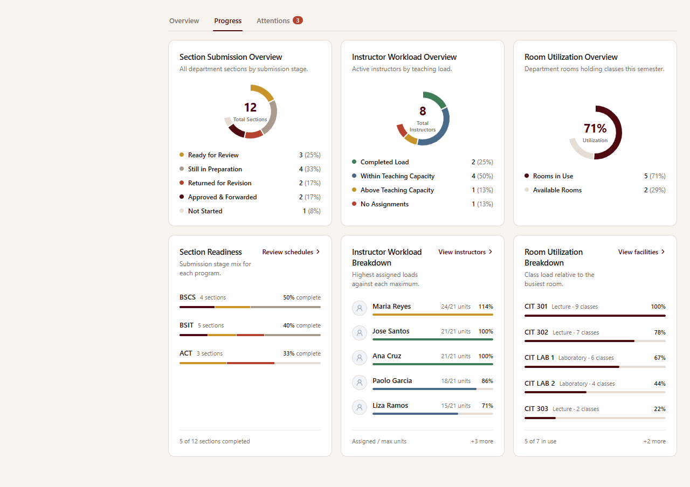

# Dean dashboard Progress tab redesign

Scope: the **Progress** tab of `src/pages/dean/DeanDashboardPage.tsx` (`?tab=progress`) and its loading twin in `src/components/ui/DashboardSkeleton.tsx`. Data sources, calculations, routes and the Overview/Attentions tabs are unchanged.

## Data sources (audited, reused as-is)

| Card | Source | Calculation reused |
| --- | --- | --- |
| Section submission / readiness | `useDepartmentScheduleStatus(departmentId)` → `/departments/{id}/schedule-status`; meetings from `/initial-data` | `readiness` stage classification (submitted / revision / approved / scheduled / not started), `packages` per-program grouping via `programOf`, `draftedCount` / `sectionTotal` |
| Instructor workload | `/initial-data` `faculties` (active, department-scoped) | `loads` (`assigned_units` vs `basicLoadOf(max_units, deload_units)`), `workloadBands`, top-5 `workload` |
| Room utilization | `/initial-data` `rooms` + active-semester meetings | `physicalRooms`, `buildRoomUsage`, `roomsInUse`, `utilization` (`src/lib/roomUsage.ts`) |

## Audit: issues in the original tab (prioritized)

| Priority | Issue | Where | Effect |
| --- | --- | --- | --- |
| **P1** | Summary and detail were fused into each card, with very different content per card. The readiness card held only a donut and legend, while the workload card added five bordered instructor cards. `items-stretch` stretched the short cards to the tallest one. | Progress `<section>` | Large blank areas at the bottom of the readiness card and an unbalanced row. |
| **P1** | Workload colors contradicted each other. The donut showed *Above Teaching Capacity* in amber. The list beneath it painted any load at or above 100% green and every under-loaded instructor amber. The bar was capped at 100%, so overload was invisible. | `InstructorWorkloadChart` inside the workload card | An overloaded instructor looked like a completed load. Amber meant two opposite things in one card. |
| **P1** | The room list showed a percentage that was the room's class count *relative to the busiest room*. It sat right under a donut whose headline percentage was *rooms in use ÷ rooms*. Neither label explained the difference. | Room Utilization card | Two unrelated "%" values side by side, which invites misreading. |
| **P1** | Actions were inconsistent. Readiness had a header action, *View all sections by status*, that actually opened the approval queue. The workload card's header action, *Instructor workload by %*, repeated its own sub-heading but navigated to Instructors. Rooms put its action as a footer link (*Go to Facility*) instead. | Panel `action` props | Labels didn't predict their destinations, and each card placed its action differently. |
| **P2** | Nested containers. Each instructor row was a bordered, padded card inside the bordered panel, with a 36px avatar. | `InstructorWorkloadChart cards` | A heavy, boxy look. Five rows took about 330px. |
| **P2** | The responsive grid jumped straight from one column to three at `xl`. Between 768 and 1279px every card ran the full width with a 128px donut. | `xl:grid-cols-3` only | Wide, mostly empty cards on tablets and small laptops. |
| **P2** | Donut legends used one decimal place (`33.3%`). With a fixed `128px` donut beside them in a one-third-width card, labels such as *Above Teaching Capacity* truncated. | `DonutLegend`, `sm:grid-cols-[128px_1fr]` | Noisy figures and clipped labels at 1280–1440px. |
| **P2** | Readiness had no breakdown, so the Dean could not see which program was lagging. Per-program data (`packages`) already existed but appeared only on the Attentions tab. | Readiness card | The most actionable view of progress was missing from the Progress tab. |
| **P3** | Unavailable rooms (`RoomUsage.isUnavailable`) were not flagged. | Room list | A closed room looked identical to an idle one. |
| **P3** | List rows had no hover feedback, and the 6px bars with mixed label alignments didn't match the dashboard's lighter metric cards. | All lists | Harder scanning and a less refined surface. |
| **P3** | The skeleton mirrored the old three-card layout. | `DeanSkeleton` progress | Layout shift when data arrives. |

### Fix order

1. Split each card into **summary** and **breakdown** cards on one coordinated grid (fixes the P1 blank space and the P2 grid jump).
2. Make one function the source of truth for workload band and color, shared by the donut and the rows (fixes the P1 color contradiction and shows overload).
3. Label the room bar as *relative to the busiest room* and show the class count (fixes the P1 ambiguity).
4. Standardize actions: one subtle header text action per breakdown card, named for its destination (fixes the P1 inconsistency).
5. Remove the nested row cards and use thin bars, integer legend percentages and a container-aware donut layout (fixes the P2 issues).
6. Add the per-program readiness breakdown, the unavailable-room flag, row hover states and the skeleton update (fixes P2 and P3).

## Resolution (2026-11-14)

All eleven findings are resolved.

| Card | Contents | Action |
| --- | --- | --- |
| Section Submission Overview | Donut (total sections) and stage legend | None |
| Section Readiness | One row per program: section count, `% complete` (the existing `packages.completion`, the same figure as the Attentions queue), and a stacked stage bar. Footer: `N of M sections completed` from `draftedCount`. | Review schedules → `/dean/schedules/approval` |
| Instructor Workload Overview | Donut (total instructors) and band legend | None |
| Instructor Workload Breakdown | Top five by assigned units: `assigned/max units`, the **uncapped** load % and a thin bar in the band color. Footer: `+N more`. | View instructors → `/dean/instructors` |
| Room Utilization Overview | Donut (utilization %) and in-use/available legend | None |
| Room Utilization Breakdown | Top five rooms: type, class count, an *Unavailable* tag, and a bar labeled as load relative to the busiest room. Footer: `N of M in use`, `+N more`. | View facilities → `/dean/facilities` |

**Layout.** The DOM pairs each summary with its breakdown. Below `xl` this gives one column of pairs. At `xl` and above, `grid-flow-col` with three columns and two auto rows puts the summaries on one row with each breakdown directly beneath. Summary cards size their chart with container queries: stacked under 20rem, donut beside legend from 20rem, and a two-column legend from 38rem (full-width tablet strips). An earlier two-column tablet layout was rejected after capture because the short summary stretched beside its tall breakdown.

**Single source of truth.** `READINESS_STAGES` and `readinessOf` drive both the department donut and the per-program bars, in one pass over the sections. `WORKLOAD_BANDS` and `workloadBandOf` drive both the donut counts and each row's bar color. The tests pin the colors so an overloaded instructor is amber and a completed load is green.

**Shared components (opt-in props, other dashboards unchanged).**

- `Donut`: added `size="sm"` (112px).
- `DonutLegend`: added `decimals`. The Dean view uses 0; the default stays 1.
- `InstructorWorkloadChart`: added `dense` and `colorOf`. The VPAA and Secretary dashboards keep their existing output.

No new dependencies, endpoints or mock data.

### Evidence

Captured from the production `DeanDashboardPage` against fixture `/api` responses. The harness is the gitignored `dean-progress-preview.local/`. A 288px left offset reproduces the open sidebar.

Also: [tablet 1024 with sidebar](dean-progress-tab-redesign/tablet-1024-sidebar.png), [phone 390](dean-progress-tab-redesign/phone-390.png), [loading skeleton](dean-progress-tab-redesign/skeleton-1440.png).

### Verification

- 80 tests passed across the Dean, VPAA and Secretary dashboards, `DashboardSkeleton` and `InstructorWorkloadChart`. Three new Dean tests cover the per-program readiness mix, uncapped overload with band colors, and the room-bar labeling.
- ESLint on the changed files, `tsc` and `vite build` passed. The built CSS contains the `@container` rules.
- Headless Chrome at 390, 820, 1024 (with sidebar), 1280 (with sidebar), 1440 and 1920px: no horizontal overflow, no console or page errors, and summary and breakdown heights equal per row on desktop.

### Remaining limits

- Room percentages are relative to the busiest room. A true hours-booked ÷ hours-available utilization would need a new calculation against the time grid and was left out of scope.
- Program grouping still uses the section-name prefix (`programOf`). See the dashboard integration plan for replacing name-based program identity.
