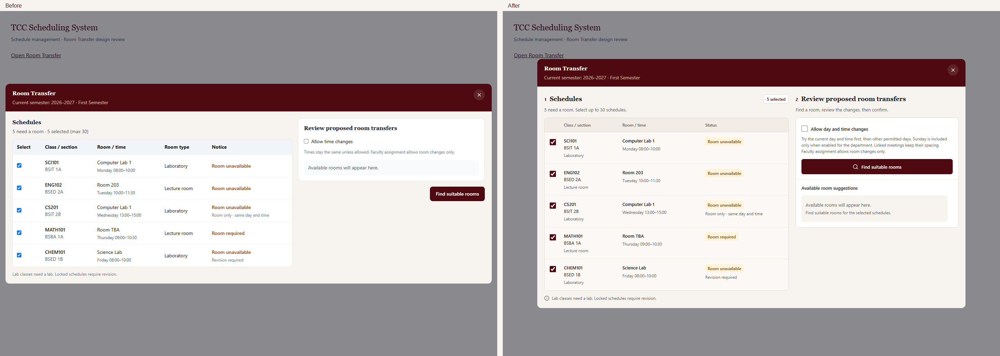
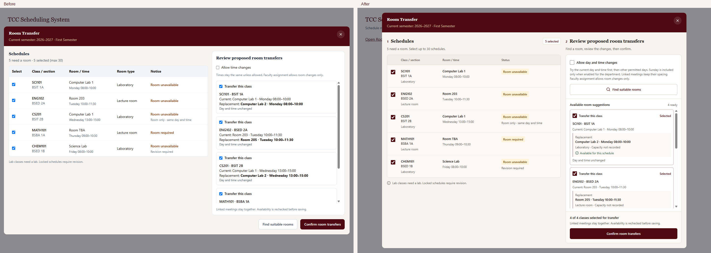
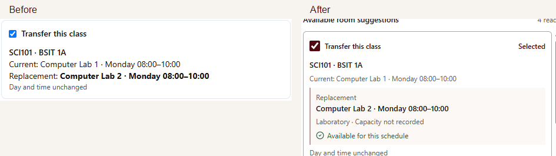
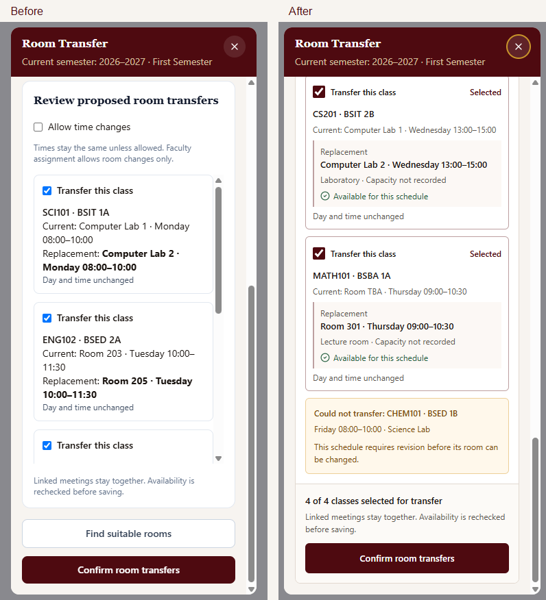

# Room Transfer modal redesign

Completed 2026-10-23. The redesign updates the existing `RoomReassignmentPanel`; recovery endpoints, active-semester resolution, authorization, selection limits, matching rules, grouped transfers, stale-preview handling, and save callbacks remain in place.

## Audit and resolved issues

| Step | Initial finding | Final behavior | Health |
| --- | --- | --- | --- |
| 1. Select schedules | The nearly full-width modal and five table columns separated room type from class details. Selection was indicated only by small blue checkboxes. | Modal width is capped at 1240px. The left pane occupies 60% of the desktop grid. Room type sits below class/section; maroon checkboxes, row shading, and a selected count clarify selection. | Passed |
| 2. Find rooms | The finder sat outside the review card, below an undifferentiated instruction block. | The full-width finder sits inside the right panel above suggestions, alongside the existing time-change option. | Passed |
| 3. Review replacements | Current and proposed details had similar emphasis. Cards omitted room type and availability labels. | Current details are subdued; replacement rooms receive a clear inset, type, explicit availability, and selected/not-selected labels. Linked meetings and unresolved explanations remain visible. | Passed |
| 4. Confirm transfers | Nested scrolling on mobile made reviewing results and reaching actions harder. | Mobile schedules reflow into readable rows and the modal body provides one scrolling flow. Desktop results scroll independently while the finder and confirmation remain visible at normal desktop heights. | Passed |
| 5. Handle feedback | Feedback consisted mainly of short text blocks. | Loading status, disabled controls during requests, error recovery, unresolved reasons, success feedback, and context-sensitive empty messages are explicit. | Passed |

## Visual evidence

The captures show the production component with isolated fixture responses. The earlier prompt referenced an attachment, but no screenshot attachment was available in this session; the existing component was the visual baseline. No real schedules were transferred during verification.

Additional captures: [tablet review](room-transfer-redesign/10-tablet-review.png), [loading](room-transfer-redesign/09-loading.png), [error](room-transfer-redesign/06-error.png), [unresolved](room-transfer-redesign/07-unresolved.png), and [success](room-transfer-redesign/08-success.png).

## Verification

- 24 focused tests passed across `RoomRecovery.test.tsx` and `Rooms.test.tsx`, including the 19 existing recovery tests plus new replacement-selection and keyboard-focus coverage.
- Targeted ESLint checks and the production TypeScript/Vite build passed.
- Headless Chromium checked widths 320, 390, 768, 1024, 1440, and 1920px. No horizontal modal overflow or outer overlay overflow was found. The desktop column ratio measured 1.5 (60/40).
- Real Tab and Shift+Tab events wrapped between the first and last modal controls. Scroll regions are keyboard focusable; Escape dismissal and focus restoration remain covered by the existing tests.
- Axe reported no WCAG A/AA rule violations in the tested desktop selection, desktop review, and mobile review states. This does not establish full accessibility compliance or replace assistive-technology testing.
- Browser runtime exceptions: none.

## Data and verification limits

The existing room schema/API has no capacity field. The UI therefore displays **Capacity not recorded** and does not invent capacity values or imply capacity matching. Room recommendations remain server-generated; selecting a proposal selects the existing complete transfer group.

Browser captures used fixture data rather than an authenticated live backend. Both baseline and final captures used the same font fallbacks; the application's existing DM Sans and Playfair Display declarations and font loading remain unchanged. Live data, external font delivery, and a manual screen-reader pass were outside this verification run.
